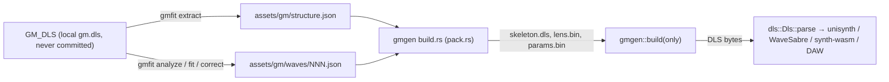

# Procedural GM bank (`crates/gmgen`, `crates/gmfit`)

Change `add-procedural-gm-bank`. The generator rebuilds the Windows `gm.dls` bank (235 instruments, 495 waves) as a
`RIFF 'DLS '` buffer. The structure (instruments, regions, articulation, wave rate, length and loop) is copied from
the original; every wave is synthesised from committed model parameters. Windows production builds play the OS
file. macOS, Linux and the DAW play the generated bank. The background on each instrument is in
`research/gm-procedural-instruments.md`.



## Data

- `structure.json` (`gm-structure/1`) holds each instrument (`drums`, `bank`, `program`, `name`, `art`, `regions`)
  and each wave (`rate`, `len`, `wsmp`). An articulation connection is written `[src, ctl, dst, trn, scale]`, and a
  `wsmp` is written `[unity, fine, gain(, loopStart, loopLen)]`.
- `waves/NNN.json` holds one parameter set per wave:

  ```json
  {"wave": 289, "gain_db": -3, "pitch": 36.1, "note": "…",
   "layers": [{"family": "additive", "region": "sustain", "p": {"d": 0.4}, "t": {"harm": [0, -6, -9]}}],
   "correction": [0, 1.5, -2],
   "tf": [[0, 1.2, ...20 band gains], ...rows]}
  ```

  `placeholder: true` marks a file written by `gmfit placeholder`, which is not fitted yet.
- **Budget.** A wave has at most 4 layers and at most 512 numbers. The count covers explicit scalars, table
  entries, correction entries and wave scalars. Omitted scalars take their defaults and do not count. The build
  rejects an over-budget wave, an unknown family or parameter, an out-of-range value, and `sustain` on a family that
  cannot be periodic. The error names the file and the wave.
- **Missing files** are rendered silent. The test `every_wave_has_parameters` then fails and lists them.

## Rendering

| Region | Meaning |
|---|---|
| `sustain` | Exactly periodic over the loop from the loop start on. Phases are integer phasors (`n/L` cycles per sample, the loop grid `rate/L`), and envelopes freeze at the loop start. Only for the periodic families (`additive`, `noise`). |
| `attack` | Free-running, faded linearly to 0 over the last 10 ms before the loop start. |
| `whole` | Unlooped waves. On a looped wave it acts as `attack`. |

Pitch: the wave-level `pitch` (MIDI) if given, otherwise the wave's unity note. The order of operations is: layers
summed, then `gain_db`, then the optional harmonic correction, then the optional `tf`, then a soft knee above 0.9, then 16-bit round-half-even. The seed is the wave
index, so full builds, partial builds and `gmfit` all render a wave identically.

**Harmonic correction** (`correct.rs`): dB gains at harmonics 1..C of f0, interpolated linearly in harmonic
number, with 0 dB beyond the table (fading over one harmonic).
- Loop: DFT, gain per bin, inverse DFT. The result is exact and stays periodic.
- Attack: a linear-phase FIR through the same curve, spanning at least 4 periods (129–2049 taps).

**Time × band correction `tf`** (`tf.rs`, design D4c): dB gains on 20 log-spaced bands (55 Hz · 1.315^b) × up to
9 rows at 0, 5, 10, 20, 40, 80, 160, 320 and 640 ms. Gains interpolate linearly in time and log-frequency.
- Applied by STFT (N 512, hop 128, Hann², own radix-2 FFT) to the attack, or to the whole unlooped wave.
- On a looped wave the gains fade to 0 dB over the last 10 ms before the loop start, and the loop is untouched.
- `tf::measure` gives band energies on the same grid, for the fit.

**Fine envelope `env`** (`tf.rs`, design D4d): dB gains at 24 fixed times (0, 0.5, 1, 2, 3, 4, 6, 8, 10, 13, 16,
20, 25, 32, 40, 50, 64, 80, 100, 130, 170, 220, 300 and 400 ms). Only the points the attack needs are stored. The
gain is a per-sample linear dB interpolation on the attack; on a looped wave it fades to 0 dB over the last 10 ms
before the loop start. On a one-shot, a last point past the wave's end takes effect at the last sample
(`env_db_end`; design D4j), so the original's end fade can be matched. `correct_env` measures that point on the
last 5 ms. It applies after `tf`, so it catches onset detail finer than the 23 ms STFT.

**Determinism.** `math.rs` provides `sin_cycles`, `exp2`, `log2`, `db`, `sqrt`, `floor` and an xorshift RNG. It uses
only basic IEEE operations. `clippy.toml` bans `f32` transcendental functions and `mul_add` in the crate.

## Families

Envelope scalars shared by `additive` and `noise`: `a` (linear attack, s), `h` (hold, s), `d` (exponential decay
time constant, s), `s` (sustain level 0–1), `dly` (silent before it, s). Defaults: 0.002, 0, 1, 1, 0. `dly` is
structural (the string-attack hand-over), so `fit` never tunes it.

### `additive` (periodic)

| Parameter | Range | Default | Meaning |
|---|---|---|---|
| `level_db` | −80…24 | 0 | layer level |
| `cents` | ±1200 | 0 | offset from the wave pitch |
| `tail` | −48…0 | −12 | dB/octave beyond the `harm` table |
| `tilt`, `tilt_t` | ±24, 0.001…10 | 0, 0.1 | extra dB/octave at onset, relaxing with `tilt_t` (brightness envelope) |
| `pdecay` | 0…10 | 0 | extra decay rate per harmonic above 1 (1/s) |
| `inharm` | 0…0.02 | 0 | stiff-string B: `f_k = k·f0·√((1+Bk²)/(1+B))` |
| `even_db` | −48…24 | 0 | even-harmonic gain (clarinet-like when negative) |
| `unison`, `detune` | 1…8, 0…50 | 1, 0 | voices and the cents spread between them |
| `vib_phase` | 0…1 cycles | 0 | vibrato phase at sample 0 (deviation ∝ cos(2π(vib_phase + rate·t))) |
| `am_db`, `am_phase` | 0…12 dB, 0…1 | 0, 0 | amplitude modulation locked to the vibrato phasor (body-resonance wobble of a vibrato loop) |
| table `am` | rows of 8 | – | per-harmonic loudness curve: [dB, phase] at 1×–4× the vibrato rate (row k = harmonic k), on the vibrato phasor |
| table `vib` | rows of 2, ≤ 8 | – | pitch curve: [cents, phase] at 1×, 2×, … the vibrato rate; overrides `vib_cents`/`vib_phase` |
| table `side` | rows of 4, ≤ 96 | – | sideband components [harmonic, loop-bin offset, dB re harmonic level, phase]; a harmonic with rows is exactly these components (its AM/FM included), with no unison/spread/vib/am |
| `phase_seed` | 0…255 | 0 | untabled harmonics: 0 = Schroeder phases, n = hashed random phases (an ensemble's scattered upper partials; Schroeder phases on a steady upper spectrum buzz once per period) |
| `spread` | 0…50 cents | 0 | ensemble: each partial is a Gaussian cluster of components (sd in cents, spacing ≥ 1 grid step, ≤ 25 components, power kept, fixed pseudo-random phases) on the loop grid. Replaces `unison` |
| `vib_rate`, `vib_cents` | 0…12, 0…100 | 0, 0 | vibrato as phase modulation, rate snapped to the loop grid |
| `scoop_cents`, `scoop_t` | ±200, 0.001…1 | 0, 0.03 | onset pitch scoop; gone by the loop start |

Tables:
- `harm`: dB per harmonic 1..K (≤ 240).
- `phase`: cycles for harmonics 1..P (≤ 32). Other harmonics get fixed Schroeder phases.

Partials above 0.45·rate or below −100 dB are culled. Amplitudes run at a 32-sample control rate.

### `noise` (periodic)

| Parameter | Range | Default | Meaning |
|---|---|---|---|
| `level_db` | −80…24 | 0 | layer level |
| `hp`, `lp` | Hz | 10, 20000 | 2-pole high-pass and low-pass |
| `sweep`, `sweep_t` | ±4 oct, 0.001…5 | 0, 0.05 | band centres move at onset (transient only) |
| `am_rate`, `am_depth` | 0…40, 0…1 | 0, 0 | amplitude modulation (rate snapped to the loop grid) |

Table `bands`: `[centre Hz, Q, gain dB]` band-passes summed in parallel (≤ 24; a cymbal wash loop uses 20 third
octaves, design D4n). Without bands the noise is white.
- Sustain: a loop-length noise pattern, filtered circularly (three passes) and tiled.
- Transient: free noise.

### `drum` (attack/whole)

| Parameter | Range | Default | Meaning |
|---|---|---|---|
| `level_db` | −80…24 | 0 | layer level |
| `freq`, `ratio`, `sweep_t` | 20…2000 Hz, 1…8, 0.001…1 | 60, 2, 0.03 | body glides from `freq·ratio` to `freq` |
| `decay`, `a` | 0.005…10, 0…0.05 | 0.3, 0.0005 | body decay and attack |
| `shape` | 0…1 | 0 | sine toward odd harmonics |
| `drive` | 0…1 | 0 | soft clip |
| `click_db`, `click_decay` | −80…12, 0.0005…0.1 | −80, 0.004 | noise beater click |

Table `modes`: extra membrane modes `[ratio, gain dB, decay s]` (≤ 3), riding the same glide.

### `metal` (attack/whole)

| Parameter | Range | Default | Meaning |
|---|---|---|---|
| `level_db` | −80…24 | 0 | layer level |
| `base` | 20…4000 Hz | 205.3 | oscillator base frequency |
| `bp`, `q`, `hp` | Hz, 0.3…20, Hz | 8000, 1.5, 6000 | band-pass, then high-pass |
| `a`, `d`, `d2`, `split` | s, s, s, 0…1 | 0.0005, 0.05, 0.05, 1 | two-stage decay: `d` down to level `split`, then `d2` |
| `noise` | 0…1 | 0 | white noise mixed into the oscillator bank |

Table `ratios`: square oscillators at `base × ratio` (≤ 6, PolyBLEP). When empty, the TR-808 set is used: 1, 1.4827,
1.8003, 2.5460, 2.6303, 3.8967 (205.3 to 800 Hz).

### `modal` (all regions; sustain exactly periodic)

A resonator of up to 32 modes struck by a train of hits. Each hit restarts a shared pitch glide, a short attack
and a band-passed noise click.

| Parameter | Range | Default | Meaning |
|---|---|---|---|
| `a h d s dly` | | | shared envelope (as `noise`); a whole-region hit train starts at `dly` |
| `level_db` | −80…24 | 0 | layer level |
| `glide`, `glide_t` | ±4800 cents, s | 0, 0.02 | modes start `glide` cents off, relaxing with `glide_t` (restarts per hit) |
| `ha` | 0…0.05 s | 0.0002 | attack of each hit |
| `hits`, `period`, `hit_db`, `jitter`, `offset` | | 1, 0.05, 0, 0, 0 | regular train (when the `hits` table is empty) |
| `click_db`, `click_decay`, `click_hp`, `click_lp` | dB, s, Hz, Hz | −80, 0.003, 1000, 20000 | noise burst per hit |
| `trill_hz`, `trill_cents` | 0…400 Hz, 0…1200 | 0, 0 | frequency modulation of every mode (a whistle's pea), restarted per hit |

Tables:
- `modes`: `[Hz, dB, decay s, phase cycles]`, absolute frequencies.
- `hits`: measured strikes `[s, dB]`, times from `dly` (sustain: from the loop start). These override the regular
  train.

In the sustain region, with at most one hit, the modes are steady tones on the loop grid with their stored phase
at the loop start: a cymbal or belltree loop made of sparse peaks. With more hits, one loop's hit pattern
(including the clicks) renders over enough loops for the tails and is folded into the loop. Both stay exactly
periodic.

Further families (`ks`, `subtractive`) arrive in task group 7.

### `shaker` (periodic; PhISEM)

| Parameter | Range | Default | Meaning |
|---|---|---|---|
| `level_db` | −80…24 | 0 | layer level |
| `rate` | 1…4000 | 100 | collisions per second at full envelope |
| `follow` | 0…1 | 1 | rate ∝ envelope^follow (0: steady rate, level still follows) |
| `sdecay` | 0.0001…0.2 s | 0.003 | decay of each collision's noise burst |
| `gjit` | 0…24 dB | 6 | per-collision level spread ± |
| `fjit` | 0…1200 cents | 0 | per-collision resonance detune ± |
| `chirp`, `chirp_t` | ±4 oct, 0.0005…0.5 s | 0, 0.01 | per-collision resonance sweep (bubbles rise) |

Table `res`: `[Hz, Q, gain dB]` (≤ 3) band-pass resonances every collision rings; none = the bare burst.
- Whole/attack: free-running Bernoulli events, each at the envelope level of its onset.
- Sustain: one loop-length event pattern, rings wrapped circularly, tiled — exactly periodic.

Analysis (`gmfit/src/shaker.rs`, design D4o): collision onsets on a 0.5 ms envelope (rate, burst decay, level
spread), ≤ 3 resonances by peak-picking the smoothed spectrum, one-shot envelope; candidates rate ×0.5/1/2, chirp
0/+1, detune 0/300 cents, Q ×1/0.25, alone or added to the current model taking 30/50/70 % of the energy; kept by rank.
Ring layers (design D4s): per third-octave band the ring index (envelope-power autocorrelation width × bandwidth;
noise 0.5, ringing ≥ 0.75) and ring τ; ringing bands grouped by τ into 1–2 shaker layers (Q = π f τ) over the
current model's hiss bed. The hearing model's `ring` (octaves, unpitched loops) reports "rings too briefly / too long".

### `fm` (all regions; sustain exactly periodic)

| Parameter | Range | Default | Meaning |
|---|---|---|---|
| `level_db` | −80…24 | 0 | layer level |
| `freq` | 0…20000 Hz | 0 | frequency of ratio 1 (0: the wave's fundamental) |
| `feedback` | 0…1.5 | 0 | self-modulation of the top operator (radians) |
| `algo` | 0…1 | 0 | 0 stack (op k modulates op k−1, op 0 sounds); 1 pairs 1→0 and 3→2 |
| `glide`, `glide_t` | ±4800 cents, 0.0005…2 s | 0, 0.02 | start pitch offset, relaxing exponentially |
| `cyc_hz`, `cyc_phase` | 0…400 Hz, 0…1 | 0, 0 | rate and start phase of the `cyc` pitch/loudness cycle |

Table `ops`: `[ratio, amount, index decay s, index sustain]` (≤ 4, row 0 the carrier). A carrier's amount is its
level (dB); a modulator's is its peak index (radians), decaying toward sustain × peak. Table `cyc`: `[cents, dB]`
points evenly over one cycle, linear and wrapping (a tweet train). Sustain renders one loop and tiles it: the cycle
rate snaps to whole cycles per loop, the base frequency to whole cycles of total phase and each ratio likewise
(feedback: one warm-up loop); glide and index envelopes freeze at the loop start.

Analysis (`gmfit/src/fm.rs`, design D4q): a chirp cycle — the loop's dominant partial tracked as an analytic signal,
cycles per loop from the repeating level track, averaged into 32 `cyc` points on a sine, the head before the train an
attack tone with its glide — and operator presets (DX7-style EP pairs 1:1 + 1:14, STK TubeBell 1:1.414 pairs, a
1:3.5 pair) with indices/decays/sustains set by scored coordinate descent; kept by rank.

### `formant` (all regions; sustain exactly periodic)

| Parameter | Range | Default | Meaning |
|---|---|---|---|
| `level_db` | −80…24 | 0 | layer level |
| `f0` | 0…4000 Hz | 0 | source pitch (0: the wave's fundamental) |
| `pw` | 0…0.5 | 0 | pulse width (0: band-limited saw) |
| `noise`, `jitter` | 0…1, 0…100 cents | 0, 0 | aspiration in the voiced source; random pitch per period |
| `breath_db` | −80…24 | −80 | noise through the formants under the layer envelope only (a laugh's "h") |
| `vib_rate`, `vib_cents` | 0…12 Hz, 0…100 cents | 0, 0 | vibrato |
| `syl_a`, `syl_d`, `syl_glide` | s, s, ±2400 cents | 0.005, 0.05, 0 | syllable attack, decay, pitch fall over the decay |

Table `formants`: `[Hz, bandwidth Hz, dB]` (≤ 5) parallel band-passes. Table `syl`: `[s, dB, cents]` (≤ 16): the
voiced source sounds only in syllables, each with its own envelope; no rows = throughout, under the layer envelope.
Sustain is computed per harmonic (source spectrum × the formants' complex response, `Biquad::response`) on the loop
grid, vibrato snapped to whole cycles per loop: exactly periodic, voiced only.

Analysis (`gmfit/src/formant.rs`, design D4r): looped voices — LPC formants on the loop, the wave's pitch; unlooped
voices — voiced syllables (5 ms envelope peaks, autocorrelation ≥ 0.5), pitch per syllable (subharmonic summation,
octaves pulled to the median), pitch fall tracked on harmonic 1–2, formants from harmonic amplitudes when f0 > 250 Hz
(LPC locks onto sparse harmonics), breath envelope fitted to the floor between syllables; formant gains and breath
re-levelled against the original in 3 render passes.

### `ks` (attack/whole; Karplus-Strong)

Extended Karplus-Strong (Jaffe–Smith) plucked string, `gmgen/src/fam/ks.rs`. Not periodic: whole waves and attack
layers; a looped wave hands over to an exact sustain layer at the loop start.

| Parameter | Range | Default | Meaning |
|---|---|---|---|
| `level_db` | −80…24 | 0 | layer level |
| `f0`, `cents` | 0…4000 Hz, ±1200 | 0 (wave pitch), 0 | string pitch |
| `pick` | 0…0.5 | 0 | pick position (fraction of the string): comb 1 − z^(−pick·N); ½ removes even harmonics |
| `damp` | 0…1 | 0.3 | loop one-zero (1 − s) + s·z⁻¹, s = damp/2: upper harmonics die faster |
| `t60` | 0.01…30 s | 2 | fundamental's 60 dB decay (sets the loop gain) |
| `stretch` | 0…0.95 | 0 | dispersion all-pass (coefficient −stretch): sharp upper partials (stiff strings) |
| `dyn` | 50…20000 Hz | 8000 | one-pole low-pass on the excitation (pluck dynamics) |
| `exc` | 0.1…8 | 1 | excitation burst length in periods |
| `buzz` | 0…1 | 0 | asymmetric bridge contact (negative half attenuated: sitar buzz) |

Table `body`: `[Hz, Q, dB]` (≤ 4) band-passes the excitation runs through (commuted body), plus the direct path.
The fractional tuning all-pass is solved by bisection against the exact phase delays of the damping and dispersion
filters at f0 (the dispersion all-pass at coefficient 0 is z⁻¹). Tests: pitch within 2 cents (110/196/440 Hz),
decay within 10 %, pick ½ removes the even harmonics, body and buzz stable.

Analysis (`gmfit/src/ks.rs`): `t60` from the decay slope of the 0.8–1.25·f0 band; damping × dynamics searched
jointly (a plucked bass only darkens enough with both), then pick, damping, dynamics, dispersion and burst length one
at a time (2 passes) on the fit objective, the level recalibrated each step. Looped waves: `ks` attack levelled on its
head (3 ms … ⅓ of the attack), sustain layers delayed to fade in over its last 10 ms and re-levelled on the loop (the
delayed envelope freezes elsewhere on its curve). Fit opens `level_db a d s t60 damp dyn stretch`.

### `subtractive` (all regions; sustain exactly periodic)

Two oscillators through a resonant filter, `gmgen/src/fam/subtractive.rs`. Oscillators are band-limited harmonic
series (saw 2/πk, pulse, triangle; below 0.45·rate); the filter (RBJ low/high/band-pass) acts per harmonic as its
complex response, recomputed every 32 samples and interpolated between. Sustain: cutoff frozen at the loop start,
partials on the loop grid — exactly periodic.

| Parameter | Range | Default | Meaning |
|---|---|---|---|
| `level_db`, `cents` | −80…24, ±1200 | 0, 0 | layer level, pitch offset |
| `wave1`, `pw1` | 0…2, 0.01…0.99 | 0, 0.5 | oscillator 1: 0 saw, 1 pulse (width), 2 triangle |
| `wave2`, `pw2`, `oct2`, `detune`, `mix2` | …, ±24 st, ±100 ¢, −80…12 dB | 0, 0.5, 0, 0, −80 | oscillator 2 (−80 dB: off) |
| `cutoff`, `res`, `kind` | 20…20000 Hz, 0.3…30, 0…2 | 20000, 0.707, 0 | filter cutoff, Q, 0 LP / 1 HP / 2 BP |
| `fenv`, `fa`, `fd` | ±8 oct, 0…2 s, 0.001…10 s | 0, 0.001, 0.2 | cutoff envelope: amount, attack, decay back to `cutoff` |

Tests: harmonic levels follow the biquad within 1 dB (LP 1 kHz Q 2), a 4-octave filter envelope puts the highs
≥ 20 dB higher early than late, sustain exact over the loop with a detuned second oscillator. Renders stay under
`render::soft_knee` (0.9) only when levelled: a resonant saw peaks above full scale at 0 dB.

Analysis (`gmfit/src/subtractive.rs`): pitched waves; waveform × cutoff (2–40 × f0) jointly, then resonance, a second
oscillator (detuned unison 7/15 ¢, ±1 octave), and the filter envelope, one step at a time on the fit objective, the
level recalibrated each step. Looped: one sustain layer; unlooped: one whole layer with the measured decay. Fit opens
`level_db a h d s pw1 detune mix2 cutoff res fenv fa fd`.

## Commands

```bash
GM_DLS=~/Downloads/64k-tools/gmdls/gm.dls cargo run -p gmfit -- extract   # assets/gm/structure.json
cargo run -p gmfit -- placeholder                                          # files for waves without one
cargo test -p gmgen --features std                                         # budget, sanity, periodic loops, determinism
GM_DLS=… cargo test -p gmgen --features std                                # + structure equals the Windows bank
GM_DLS=… cargo run --release -p gmfit -- render 289                       # build/gm/289/{orig,gen}.wav, sheet.png, report.json
GM_DLS=… cargo run --release -p gmfit -- sweep 289 0.d 0.1,0.3,1          # scored variants + sweep.png
GM_DLS=… cargo run --release -p gmfit -- report --check                   # build/gm/report.md + bank.png; regression gate
cargo run --release -p gmfit -- bank                                       # build/gm/gen.dls (the generated bank as a file)
GM_DLS=… cargo run --release -p gmfit -- bank --orig -o build/gm/orig.dls  # the original through the same DLS writer
```

## The gmplus set (`--set plus`, change `add-gmplus-bank`)

A second parameter set, `assets/gm-plus/`, is fitted to the gmplus soundfont (Sound Canvas samples, 32 kHz) instead
of Windows `gm.dls`. It keeps the gm.dls skeleton: the same instruments, regions, articulation and wave indices, so
every song plays unchanged. Each wave moves to 32 kHz, and its length and loop come from the gmplus target.

- **Inputs.** The soundfont comes from `GMPLUS_SF2`, a local `gmplus.sf2` that is never committed (Release 1, see
  `research/gm-procedural-instruments.md` §4). `GM_DLS` is still needed, for level matching and the one fallback.
- **Targets** (`crates/gmfit/src/plus.rs`, design D2):
  - The zones are the ones gmplus plays at the wave's key (`main_user`: the region `play_speed` picks), at velocity
    100. Layered zones (93 waves) are all rendered and summed, with `initialAttenuation` × 0.4 (E-mu / FluidSynth)
    relative to the loudest zone.
  - Each sample is resampled to 32 kHz (`dsp.rs`, Kaiser sinc) so the gm.dls region playing it at that key sounds as
    gmplus does. gmplus's own tuning is kept, including its stretched piano. DC: a looped sample loses its loop's
    mean; a one-shot goes through a 10 Hz high-pass.
  - The mod envelope bends pitch (`modEnvToPitch`) and sweeps the zone low-pass (`modEnvToFilterFc`) through the
    attack, up to 1 s, then freezes for the loop.
  - The first looped zone sets the loop: a whole number of its source loops (up to 256) with an integer length. The
    other zones lock to it when it holds whole source loops of them within 1 cent; otherwise (detuned unisons, noise,
    fifths: 76 waves) they keep their exact pitch and are crossfaded across the loop end. The largest residual is
    0.448 cent. One-shot zones end before the loop.
  - Fitting: on the plus set a string-attack hand-over is only used when the loop starts within 0.3 s
    (`analyze.rs` `HANDOVER_MAX_S`). After a long baked attack it was heard as a break mid-note (240, 293: a 2–3 dB
    hole then a step at the loop, which the score averages away); late loops use a sustain layer from the start.
  - The target is level-matched to the gm.dls wave: the loudest 100 ms (A-weighted RMS) of the first 1 s played.
    Peaks above 0.85 move into the wsmp gain.
- **Map.** `gmfit plus-map` writes `assets/gm-plus/map.json` (`gm-plus-map/1`, one row per wave, no audio): preset,
  key, zone, sample, step, loop, `fine_delta`, `wsmp_gain_db`, filter, pitch envelope, freeze time, and `fallback`
  for a wave with no gmplus zone. Only wave 366, Gt. Feedback (bank 8, program 31), falls back.
- **Render.** With `--set plus`, `render` draws three rows in `sheet.png` (target, generated, the gm.dls wave resampled
  to 32 kHz), and `report.json` carries the wave's map row as `gmplus`.
- **Set selection.** `--set plus` on any command uses `assets/gm-plus/` and `build/gm-plus/`, and fits the gmplus
  targets. Without `--set` every command behaves as before; `render 293` is byte-identical.

- **Generation cost** (task 2.3, measured with `cargo run --release -p gmgen --features plus --example bench_sets`,
  native, one thread, before any optimisation):

  | Set | Samples | Full build |
  |---|---|---|
  | gm (committed fits) | 1.54 M | 6.8 s |
  | plus skeleton with the gm parameters | 10.82 M (7.0×) | ≈ 54 s |
  | plus, layered targets (3.3 review) | 12.46 M (8.1×) | ≈ 1 min (est.) |

  The 7× comes from 32 kHz, gmplus's longer native samples, and up to 1 s of baked envelope motion. Without baking it
  would be 2.6×; with a 0.25 s limit, 3.5×. Fidelity was chosen over load time (1 s kept). Generation speed is the
  open budget item of `add-procedural-gm-bank` 9.4 (≤ 300 ms native, ≤ 1 s wasm for the gm set). `tests_plus.rs`
  `plus_sample_budget` fails above 13 M samples.

```bash
export GM_DLS=~/Downloads/64k-tools/gmdls/gm.dls GMPLUS_SF2=~/Downloads/64k-tools/gmplus/gmplus.sf2
cargo run --release -p gmfit -- plus-map                 # assets/gm-plus/map.json (~7 s, 12 threads)
cargo run --release -p gmfit -- --set plus render 293     # build/gm-plus/293/
cargo test --release -p gmfit --test plus                 # piano targets vs a naive gmplus render (< 1 cent)
```

## Full-song A/B (`tools/gm-songs`)

Single-wave scores do not show how the bank sounds in music, so whole General MIDI songs are rendered through
both banks and compared. The songs are curated sets, kept in `build/gm/midi/` and never committed:

- `novak/`: the 46 DOS-game tracks of John Novak's *Grand MS-DOS gaming General MIDI showdown* (archive.org
  `DOS-Gaming-General-MIDI-Comparison`, `midi-files.zip`; `test-tone` skipped).
- `gus/`: *The Very Best of GUS MIDI* (archive.org `BESTMID6`, all seven zips), ~720 files hand-picked in 1994 as
  files that sound good on any GM card. `select` takes 24 of them greedily by coverage: a new melodic program
  counts 1 and a new drum key 0.25 (45 s to 8 min, at least 3 channels).

The renderer is Apple's AUMIDISynth (`render.swift`, offline, float WAV) for both banks. AUMIDISynth refuses the
Windows file itself (`-10871`), so the original is re-written by `gmfit bank --orig`. Both files then have the same
layout and articulation, and only the waves differ. AUMIDISynth also identifies waves by their `INFO`/`INAM` name.
The `dls::write` output has no wave names, so every region would play the first sample loaded (Piano 1, wave 289).
`prepare` therefore names the waves in render copies (`dlsname.ts`, `build/gm/songs/banks/`). It then checks that
zeroing wave 150 silences an Organ 1 note. Every sounding channel is also rendered solo, with the other
channels' notes removed and their controllers kept.

The metrics are ΔLUFS (generated − original) and `tf`. `tf` is the mean |Δ dB| of third-octave band levels per
46 ms frame after the overall gain is removed. It measures timbre over time; 0 means identical. Octave LTAS
differences are also listed. Stems more than 20 dB below the mix are left out of the instrument ranking.

**Four-way (change add-gmplus-bank).** Every song and stem is rendered through four banks: gm.dls, gmplus.sf2
(AUMIDISynth plays SF2 directly), gen-gm (`build/gm/gen.dls`) and gen-plus (`build/gm-plus/gen.dls`). Metrics:
gen-gm↔gm.dls (top-level fields, as before), gen-plus↔gmplus (`plus`), gmplus↔gm.dls (`sf`). The page shows a
"plus fitted" column, the share of a stem's notes on gen-plus waves that hold a fit (not a placeholder), computed at
page time from `assets/gm-plus/waves/`. Until the bulk fit, the gen-plus column is meaningful only where that is high.
`waves.html` holds all 495 sounds with the same four versions: gm.dls wave and gen-gm (from `gmfit dump`), the gmplus
target and gen-plus (from `gmfit --set plus dump`), each played as stored with the loop repeated to 2 s, with
gmfit scores, the gmplus sample name, and filters for category and fitted waves. One player per page; keys 1–4
switch bank at the same position.

```bash
swiftc -O tools/gm-songs/render.swift -o build/gm/songs/gmrender
gmfit bank --orig -o build/gm/orig.dls && gmfit bank && gmfit --set plus bank -o build/gm-plus/gen.dls
bun tools/gm-songs/run.ts select            # build/gm/songs/selection.json
GMPLUS_SF2=… bun tools/gm-songs/run.ts prepare   # named render copies of the 3 DLS + gmplus.sf2, renderer self-check per bank
bun tools/gm-songs/run.ts render [--shard i/n]  # mixes + solo channels × 4 banks → results*.json, mp3 (stems: 30 s excerpts)
gmfit dump build/gm/songs/waves/gm && gmfit --set plus dump build/gm/songs/waves/plus
bun tools/gm-songs/run.ts waves             # build/gm/songs/waves/NNN-{orig,sf,gen,plus}.mp3
bun tools/gm-songs/run.ts page              # build/gm/songs/index.html (songs) + waves.html (sounds) + report.md
bun tools/gm-songs/run.ts serve [port]      # http://localhost:60941/ — serve it with Range support
```

Serve the pages with `serve`: seeking and same-position bank switching need Range requests (206); a server that
answers 200 (e.g. the dashboard's mockup server) resets every switch to the start.

gen-plus stereo: AUMIDISynth plays mono waves, so `prepare` writes `banks/plus-R.dls`, a copy whose paired left waves hold their partners' PCM, and every gen-plus render is two passes: the left output of `plus.dls` and the right output of `plus-R.dls` (exact: `prepare` checks that a render is deterministic).

Cost: about 6 min per song per process (renders take ~1 s per bank; metrics and mp3 dominate), so the 70 songs
take about an hour on 8 shards. The sounds step takes under 30 s.

## Score (`crates/gmfit/src/score.rs`, design D6)

Both waves are "played": the attack, then the loop repeated to 0.5 s.

| Component | Measures |
|---|---|
| `d_spec` | mean dB difference of A-weighted log-mel spectrograms (≥ 2 periods/512/2048-point frames centred from t = 0, floored at peak − 50 dB, first 50 ms weighted double) |
| `d_onset` | the same, over the frames in the first 50 ms only (attacks and clicks) |
| `d_env` | mean dB difference of RMS envelopes (window ≥ 2 periods and ≥ 10 ms, every 2 ms) over the attack. Over the loop: 100 ms-smoothed envelopes plus the difference in wobble depth (fine-envelope sd) |
| `d_loop` | mean dB difference of the loop's exact DFT bins (DC excluded) |
| `d_per` | periodicity difference: mean over 30 ms frames (first 300 ms) of the best normalised autocorrelation at 0.5–25 ms lags. Tone vs noise of the same spectrum (design D4l) |

| `d_mod` | wavelet modulation of the original's strongest partial: flutter dB / 6 + pitch movement cents / 100 + |log₂ rate ratio| (each ≤ 1); only for a tonal original whose partial is loud ≥ 100 ms (design D4m) |

`score = exp(−(d_spec/12 + d_onset/12 + d_env/6 + d_loop/12 + d_per + d_mod))`; flags `tone_off` (`d_per` > 0.25) and `mod_off` (`d_mod` > 0.5). A-weighting and the onset term came from listening:
the kick's missing click had cost almost nothing. Tiers: A ≥ 0.85, B ≥ 0.70, C below that; a `buzz`, `clipped`, `loop_click`, `silent` or `nan` flag means C. Flags: `silent`,
`clipped`, `nan`, `env_off` (10 ms span > 6 dB off where the original is above −40 dB), `pitch_off` (autocorrelation
f0 > 5 cents off, pitched waves only) and `loop_click`.

Character descriptors (design D4n, `desc.rs`, not scored; `evaluate`/`render` add them as `desc` and flags):
`lines` (fine spectral contrast ≥ 6 dB above an original that is a noise wash: a comb where a cymbal is noise),
`transient_off` (percussive share off by ≥ 0.2: jingles, bubbles), `peaks_off` (peaks per frame off by ≥ 1.6×).
Versions of a wave are compared by rank = score − 0.1 per character flag (`keep_if_better`, `report --check`).

Hearing model (design D4p): `gmfit hear <w> [-p f]` reports what a listener hears of the difference at bank speed —
`added`/`missing` loudness above a JND plus the original's own fluctuation (where and when), `flutter` and `swell`
differences, and plain verdict lines. Below 0.05 / 0.02 the copy is as close as an independent take of the same noise.
After the first 150 ms it compares each band's level distribution, not frame by frame, so a texture re-rolled with
another seed hears the same. Version rank and fit objective subtract 0.5 × the audible excess over those floors.

Playback speed: `gmfit render` writes `play: {key, speed, by}` into `report.json`. Speed = 2^((key − unity)/12 +
fine/1200), using the region's own unity/fine and the key the bank triggers the wave from. That key is the drum
kit's key (Standard kit first), or for a melodic wave the unity note clamped to its main instrument's key range.
Listening pages play at this speed with pitch following it (belltree 49 ×0.71, SFX-kit bird ×0.38; kick ×1).

## Analysis and fitting (`crates/gmfit`)

**Priors** (`priors.rs`): each GM program and drum key maps to preferred families, best first. `analyze` takes the
first implemented one. The table also holds the physical starting values: mode ratios, 808 oscillators, SATB
vowels, Hammond footages, piano B, vibrato and scoop.

**`gmfit analyze <w> [--force] [-o f]`** (`analyze.rs`) overwrites only placeholders unless `--force` is given.
- Pitch: `m = round(L·f0/rate)` periods per loop, so the wave pitch is exactly `m·rate/L`.
- Sustain `additive`:
  - The harmonic table is the cluster energy within ±m/2 bins of `k·m`.
  - Wide clusters (median ≥ 4 peaks within 10 dB, sd ≥ 3 cents over harmonics 1–20) give `spread` = the median
    sd, with no phase table. Otherwise two strong peaks give `unison` 2 and `detune`.
  - Loop vibrato (`loop_vibrato`): the pitch track of harmonic 1 over the tiled loop sets the periods per loop from
    its mean. A sinusoid at whole cycles per loop gives `vib_rate`/`vib_cents`/`vib_phase`, and the loudness track
    gives `am_db`/`am_phase`. With vibrato, neither `spread` nor `unison` is set.
  - With vibrato and the budget for it, `loop_modulation` reads each harmonic's complex envelope (its cluster bins,
    analytic, inverse DFT). The `am` rows come from the dB envelope projected on 1×–4× the rate (first 12
    harmonics; the harmonic table is lowered by the modulation's power excess). The `vib` rows come from harmonic
    1's smoothed instantaneous frequency projected on 1×–6×.
  - With room left after the `am` rows, harmonics 1–12 get `side` rows: the strongest cluster bins until 99.5 %
    of the energy (≤ 11), scaled to the cluster energy. These harmonics are then exact on the loop.
  - Inharmonic priors centre each loop cluster on the stretched partial (running B).
  - Drums get a broadband `noise` layer like snares (bands below 2× the body removed, level from the energy share
    above it).
  - Struck strings with an inharmonic prior, and plucked strings, get a stiff-string `attack` layer when the
    attack lasts at least 50 ms (`string_attack`).
    - Its table, `inharm` (B) and `pdecay` come from partial peaks in an early and a late zero-padded spectrum.
    - The sustain layer then waits (`dly` = loop start − 10 ms, `a` 10 ms), so stretched and grid partials never
      overlap.
    - The string layer carries the attack alone (no half-level recalibration). The hammer-noise layer was dropped:
      it added nothing measurable.
  - `fit` keeps structural scalars fixed: `unison`, `dly`, `spread`, `vib_rate` on sustain layers, and the
    envelope of a delayed layer.
  - Peak positions give `inharm` when the prior is inharmonic.
  - Phases of the first 32 harmonics are converted to the generator's convention.
  - `tail` −48 dB/oct.
- Envelope: attack = rise to 70 % of the RMS peak, hold up to the peak, decay to the loop level.
- The level of each layer is calibrated by rendering it alone and matching RMS.
- A periodic `noise` layer models the inter-harmonic residual when it is above −25 dB.
- Percussive priors add an `attack` layer (`drum`, `metal` or `noise`).
- Unlooped waves get one `whole` layer from the prior (plus noise for snares).

**`gmfit fit <w> [--iters 40] [--seed 1] [--vars 0.d,gain_db]`** (`fit.rs`, `cmaes.rs`):
- Full-covariance CMA-ES over the explicit scalars plus `gain_db`, with populations scored in parallel.
- Then 3 analytic passes over the sustain harmonic table.
- The result is written only if it beats the committed score. `scores.json` is updated and `placeholder` cleared.

**`gmfit refine <w> [--rounds 3] [--iters 80]`**: alternates `fit` (with the correction tables in place) and
`correct`, stopping when a round gains less than 0.002. It is cheap, but it rarely gains: in the pilot only the hat
moved, by +0.008.

**`gmfit correct <w>`**: the analytic harmonic correction `20·log10(|orig_k| / |model_k|)` at loop bins `k·m`
(2048-point spectrum for unlooped waves), clamped to ±24 dB. Entries under 0.5 dB, or 80 dB below the strongest
harmonic, become 0. Harmonic levels are cluster energies (±m/2 bins around k·m), so inharmonic and detuned
partials count. The table is limited by the remaining budget. `correct` then fits `tf`: each cell moves by
original − model band energy over the attack, over 4 passes, keeping the best (the harmonic table's tail is trimmed
if the budget needs room). Last, the fine envelope `env` (24 points, 0–400 ms): each point moves by original −
model RMS level around it, over 6 passes (room is taken from the harmonic table, then from the last `tf` rows). The
result is kept only if better.

| Pilot (old score) | first fit | + harmonic + `tf` | + `env`, `refine`, new models |
|---|---|---|---|
| kick 376 | 0.67 | 0.74 | 0.88 |
| snare 161 | 0.45 | 0.70 | 0.76 |
| hat 83 | 0.57 | 0.66 | 0.78 |
| Strings 405 | 0.60 | 0.68 | 0.71 (`spread`) |
| Piano 293 | 0.74 | 0.84 | 0.85 (stiff-string alternative 0.84) |
| Fingered Bass 240 | 0.956 | 0.985 | 0.985 |

Round 10: gap noise calibrated by per-band periodicity (no hiss). Round 8: Strings with gap noise (`gap_noise`: periodic noise layer from the floor between the harmonics).
Round 7: Strings without buzz (`phase_seed`; scorer flag `buzz`). Round 6: Strings 0.815 (`side` rows, 512-number budget). Round 5: Strings 0.79 (per-harmonic `am` + `vib` tables). Round 4 under the A-weighted score with `d_onset`: kick 0.70 (from 0.41 with the drum noise layer), snare 0.68,
hat 0.65, Bass 0.89, Strings 0.67 (loop vibrato + AM), Piano 0.75 (stiff string + stretched loop).

| Measured (pilot preparation) | Score |
|---|---|
| Organ 1 wave 150, `analyze` only | 0.994 |
| Organ wave 151 / 6, `analyze` only | 0.93 / 0.85 |
| Detuned Organ wave 121: analyze → fit 40 iterations (2 s) | 0.41 → 0.47 |
