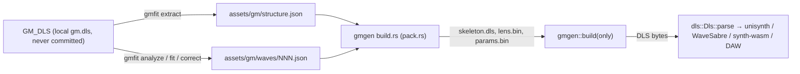

# Procedural GM bank (`crates/gmgen`, `crates/gmfit`)

Change `add-procedural-gm-bank`. The generator rebuilds the Windows `gm.dls` bank (235 instruments, 495 waves) as a
`RIFF 'DLS '` buffer. The structure (instruments, regions, articulation, wave rate, length and loop) is copied from
the original; every wave is synthesised from committed model parameters. Windows production builds play the OS
file. macOS, Linux and the DAW play the generated bank. The background on each instrument is in
`research/gm-procedural-instruments.md`.



## Data

- `structure.json` (`gm-structure/1`) holds each instrument (`drums`, `bank`, `program`, `name`, `art`, `regions`)
  and each wave (`rate`, `len`, `wsmp`). An articulation connection is written `[src, ctl, dst, trn, scale]`, and a
  `wsmp` is written `[unity, fine, gain(, loopStart, loopLen)]`.
- `waves/NNN.json` holds one parameter set per wave:

  ```json
  {"wave": 289, "gain_db": -3, "pitch": 36.1, "note": "…",
   "layers": [{"family": "additive", "region": "sustain", "p": {"d": 0.4}, "t": {"harm": [0, -6, -9]}}],
   "correction": [0, 1.5, -2]}
  ```

  `placeholder: true` marks a file written by `gmfit placeholder`, which is not fitted yet.
- **Budget.** A wave has at most 4 layers and at most 256 numbers. The count covers explicit scalars, table
  entries, correction entries and wave scalars. Omitted scalars take their defaults and do not count. The build
  rejects an over-budget wave, an unknown family or parameter, an out-of-range value, and `sustain` on a family that
  cannot be periodic. The error names the file and the wave.
- **Missing files** are rendered silent. The test `every_wave_has_parameters` then fails and lists them.

## Rendering

| Region | Meaning |
|---|---|
| `sustain` | Exactly periodic over the loop from the loop start on. Phases are integer phasors (`n/L` cycles per sample, the loop grid `rate/L`), and envelopes freeze at the loop start. Only for the periodic families (`additive`, `noise`). |
| `attack` | Free-running, faded linearly to 0 over the last 10 ms before the loop start. |
| `whole` | Unlooped waves. On a looped wave it acts as `attack`. |

Pitch: the wave-level `pitch` (MIDI) if given, otherwise the wave's unity note. The order of operations is: layers
summed, then `gain_db`, then the optional harmonic correction, then 16-bit round-half-even. The seed is the wave
index, so full builds, partial builds and `gmfit` all render a wave identically.

**Harmonic correction** (`correct.rs`): dB gains at harmonics 1..C of f0, interpolated linearly in harmonic
number, with 0 dB beyond the table (fading over one harmonic).
- Loop: DFT, gain per bin, inverse DFT. The result is exact and stays periodic.
- Attack: a 129-tap linear-phase FIR through the same curve.

**Determinism.** `math.rs` provides `sin_cycles`, `exp2`, `log2`, `db`, `sqrt`, `floor` and an xorshift RNG. It uses
only basic IEEE operations. `clippy.toml` bans `f32` transcendental functions and `mul_add` in the crate.

## Families

Envelope scalars shared by `additive` and `noise`: `a` (linear attack, s), `h` (hold, s), `d` (exponential decay
time constant, s), `s` (sustain level 0–1). Defaults: 0.002, 0, 1, 1.

### `additive` (periodic)

| Parameter | Range | Default | Meaning |
|---|---|---|---|
| `level_db` | −80…24 | 0 | layer level |
| `cents` | ±1200 | 0 | offset from the wave pitch |
| `tail` | −48…0 | −12 | dB/octave beyond the `harm` table |
| `tilt`, `tilt_t` | ±24, 0.001…10 | 0, 0.1 | extra dB/octave at onset, relaxing with `tilt_t` (brightness envelope) |
| `pdecay` | 0…10 | 0 | extra decay rate per harmonic above 1 (1/s) |
| `inharm` | 0…0.02 | 0 | stiff-string B: `f_k = k·f0·√((1+Bk²)/(1+B))` |
| `even_db` | −48…24 | 0 | even-harmonic gain (clarinet-like when negative) |
| `unison`, `detune` | 1…3, 0…50 | 1, 0 | voices and the cents spread between them |
| `vib_rate`, `vib_cents` | 0…12, 0…100 | 0, 0 | vibrato as phase modulation, rate snapped to the loop grid |
| `scoop_cents`, `scoop_t` | ±200, 0.001…1 | 0, 0.03 | onset pitch scoop; gone by the loop start |

Tables:
- `harm`: dB per harmonic 1..K (≤ 240).
- `phase`: cycles for harmonics 1..P (≤ 32). Other harmonics get fixed Schroeder phases.

Partials above 0.45·rate or below −100 dB are culled. Amplitudes run at a 32-sample control rate.

### `noise` (periodic)

| Parameter | Range | Default | Meaning |
|---|---|---|---|
| `level_db` | −80…24 | 0 | layer level |
| `hp`, `lp` | Hz | 10, 20000 | 2-pole high-pass and low-pass |
| `sweep`, `sweep_t` | ±4 oct, 0.001…5 | 0, 0.05 | band centres move at onset (transient only) |
| `am_rate`, `am_depth` | 0…40, 0…1 | 0, 0 | amplitude modulation (rate snapped to the loop grid) |

Table `bands`: `[centre Hz, Q, gain dB]` (≤ 8). Without bands the noise is white.
- Sustain: a loop-length noise pattern, filtered circularly (three passes) and tiled.
- Transient: free noise.

### `drum` (attack/whole)

| Parameter | Range | Default | Meaning |
|---|---|---|---|
| `level_db` | −80…24 | 0 | layer level |
| `freq`, `ratio`, `sweep_t` | 20…2000 Hz, 1…8, 0.001…1 | 60, 2, 0.03 | body glides from `freq·ratio` to `freq` |
| `decay`, `a` | 0.005…10, 0…0.05 | 0.3, 0.0005 | body decay and attack |
| `shape` | 0…1 | 0 | sine toward odd harmonics |
| `drive` | 0…1 | 0 | soft clip |
| `click_db`, `click_decay` | −80…12, 0.0005…0.1 | −80, 0.004 | noise beater click |

Table `modes`: extra membrane modes `[ratio, gain dB, decay s]` (≤ 3), riding the same glide.

### `metal` (attack/whole)

| Parameter | Range | Default | Meaning |
|---|---|---|---|
| `level_db` | −80…24 | 0 | layer level |
| `base` | 20…4000 Hz | 205.3 | oscillator base frequency |
| `bp`, `q`, `hp` | Hz, 0.3…20, Hz | 8000, 1.5, 6000 | band-pass, then high-pass |
| `a`, `d`, `d2`, `split` | s, s, s, 0…1 | 0.0005, 0.05, 0.05, 1 | two-stage decay: `d` down to level `split`, then `d2` |
| `noise` | 0…1 | 0 | white noise mixed into the oscillator bank |

Table `ratios`: square oscillators at `base × ratio` (≤ 6, PolyBLEP). When empty, the TR-808 set is used: 1, 1.4827,
1.8003, 2.5460, 2.6303, 3.8967 (205.3 to 800 Hz).

Further families (`ks`, `modal`, `formant`, `subtractive`, `shaker`, `fm`) arrive in task group 7.

## Commands

```bash
GM_DLS=~/Downloads/64k-tools/gmdls/gm.dls cargo run -p gmfit -- extract   # assets/gm/structure.json
cargo run -p gmfit -- placeholder                                          # files for waves without one
cargo test -p gmgen --features std                                         # budget, sanity, periodic loops, determinism
GM_DLS=… cargo test -p gmgen --features std                                # + structure equals the Windows bank
GM_DLS=… cargo run --release -p gmfit -- render 289                       # build/gm/289/{orig,gen}.wav, sheet.png, report.json
GM_DLS=… cargo run --release -p gmfit -- sweep 289 0.d 0.1,0.3,1          # scored variants + sweep.png
GM_DLS=… cargo run --release -p gmfit -- report --check                   # build/gm/report.md + bank.png; regression gate
```

## Score (`crates/gmfit/src/score.rs`, design D6)

Both waves are "played": the attack, then the loop repeated to 0.5 s.

| Component | Measures |
|---|---|
| `d_spec` | mean dB difference of log-mel spectrograms (128/512/2048-point, floor −80 dB, first 50 ms weighted double) |
| `d_env` | mean dB difference of 2 ms RMS frames |
| `d_loop` | mean dB difference of the loop's exact DFT bins |

`score = exp(−(d_spec/12 + d_env/6 + d_loop/12))`. Tiers: A ≥ 0.95, B ≥ 0.85, C below that. Flags: `silent`,
`clipped`, `nan`, `env_off` (10 ms span > 6 dB off where the original is above −40 dB), `pitch_off` (autocorrelation
f0 > 5 cents off, pitched waves only) and `loop_click`.
