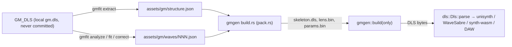

# Procedural GM bank (`crates/gmgen`, `crates/gmfit`)

Change `add-procedural-gm-bank`. The generator rebuilds the Windows `gm.dls` bank (235 instruments, 495 waves) as a
`RIFF 'DLS '` buffer. The structure (instruments, regions, articulation, wave rate, length and loop) is copied from
the original; every wave is synthesised from committed model parameters. Windows production builds play the OS
file. macOS, Linux and the DAW play the generated bank. The background on each instrument is in
`research/gm-procedural-instruments.md`.



## Data

- `structure.json` (`gm-structure/1`) holds each instrument (`drums`, `bank`, `program`, `name`, `art`, `regions`)
  and each wave (`rate`, `len`, `wsmp`). An articulation connection is written `[src, ctl, dst, trn, scale]`, and a
  `wsmp` is written `[unity, fine, gain(, loopStart, loopLen)]`.
- `waves/NNN.json` holds one parameter set per wave:

  ```json
  {"wave": 289, "gain_db": -3, "pitch": 36.1, "note": "…",
   "layers": [{"family": "additive", "region": "sustain", "p": {"d": 0.4}, "t": {"harm": [0, -6, -9]}}],
   "correction": [0, 1.5, -2],
   "tf": [[0, 1.2, ...20 band gains], ...rows]}
  ```

  `placeholder: true` marks a file written by `gmfit placeholder`, which is not fitted yet.
- **Budget.** A wave has at most 4 layers and at most 512 numbers. The count covers explicit scalars, table
  entries, correction entries and wave scalars. Omitted scalars take their defaults and do not count. The build
  rejects an over-budget wave, an unknown family or parameter, an out-of-range value, and `sustain` on a family that
  cannot be periodic. The error names the file and the wave.
- **Missing files** are rendered silent. The test `every_wave_has_parameters` then fails and lists them.

## Rendering

| Region | Meaning |
|---|---|
| `sustain` | Exactly periodic over the loop from the loop start on. Phases are integer phasors (`n/L` cycles per sample, the loop grid `rate/L`), and envelopes freeze at the loop start. Only for the periodic families (`additive`, `noise`). |
| `attack` | Free-running, faded linearly to 0 over the last 10 ms before the loop start. |
| `whole` | Unlooped waves. On a looped wave it acts as `attack`. |

Pitch: the wave-level `pitch` (MIDI) if given, otherwise the wave's unity note. The order of operations is: layers
summed, then `gain_db`, then the optional harmonic correction, then the optional `tf`, then a soft knee above 0.9, then 16-bit round-half-even. The seed is the wave
index, so full builds, partial builds and `gmfit` all render a wave identically.

**Harmonic correction** (`correct.rs`): dB gains at harmonics 1..C of f0, interpolated linearly in harmonic
number, with 0 dB beyond the table (fading over one harmonic).
- Loop: DFT, gain per bin, inverse DFT. The result is exact and stays periodic.
- Attack: a linear-phase FIR through the same curve, spanning at least 4 periods (129–2049 taps).

**Time × band correction `tf`** (`tf.rs`, design D4c): dB gains on 20 log-spaced bands (55 Hz · 1.315^b) × up to
9 rows at 0, 5, 10, 20, 40, 80, 160, 320 and 640 ms. Gains interpolate linearly in time and log-frequency.
- Applied by STFT (N 512, hop 128, Hann², own radix-2 FFT) to the attack, or to the whole unlooped wave.
- On a looped wave the gains fade to 0 dB over the last 10 ms before the loop start, and the loop is untouched.
- `tf::measure` gives band energies on the same grid, for the fit.

**Fine envelope `env`** (`tf.rs`, design D4d): dB gains at 24 fixed times (0, 0.5, 1, 2, 3, 4, 6, 8, 10, 13, 16,
20, 25, 32, 40, 50, 64, 80, 100, 130, 170, 220, 300 and 400 ms). Only the points the attack needs are stored. The
gain is a per-sample linear dB interpolation on the attack; on a looped wave it fades to 0 dB over the last 10 ms
before the loop start. On a one-shot, a last point past the wave's end takes effect at the last sample
(`env_db_end`; design D4j), so the original's end fade can be matched. `correct_env` measures that point on the
last 5 ms. It applies after `tf`, so it catches onset detail finer than the 23 ms STFT.

**Determinism.** `math.rs` provides `sin_cycles`, `exp2`, `log2`, `db`, `sqrt`, `floor` and an xorshift RNG. It uses
only basic IEEE operations. `clippy.toml` bans `f32` transcendental functions and `mul_add` in the crate.

## Families

Envelope scalars shared by `additive` and `noise`: `a` (linear attack, s), `h` (hold, s), `d` (exponential decay
time constant, s), `s` (sustain level 0–1), `dly` (silent before it, s). Defaults: 0.002, 0, 1, 1, 0. `dly` is
structural (the string-attack hand-over), so `fit` never tunes it.

### `additive` (periodic)

| Parameter | Range | Default | Meaning |
|---|---|---|---|
| `level_db` | −80…24 | 0 | layer level |
| `cents` | ±1200 | 0 | offset from the wave pitch |
| `tail` | −48…0 | −12 | dB/octave beyond the `harm` table |
| `tilt`, `tilt_t` | ±24, 0.001…10 | 0, 0.1 | extra dB/octave at onset, relaxing with `tilt_t` (brightness envelope) |
| `pdecay` | 0…10 | 0 | extra decay rate per harmonic above 1 (1/s) |
| `inharm` | 0…0.02 | 0 | stiff-string B: `f_k = k·f0·√((1+Bk²)/(1+B))` |
| `even_db` | −48…24 | 0 | even-harmonic gain (clarinet-like when negative) |
| `unison`, `detune` | 1…8, 0…50 | 1, 0 | voices and the cents spread between them |
| `vib_phase` | 0…1 cycles | 0 | vibrato phase at sample 0 (deviation ∝ cos(2π(vib_phase + rate·t))) |
| `am_db`, `am_phase` | 0…12 dB, 0…1 | 0, 0 | amplitude modulation locked to the vibrato phasor (body-resonance wobble of a vibrato loop) |
| table `am` | rows of 8 | – | per-harmonic loudness curve: [dB, phase] at 1×–4× the vibrato rate (row k = harmonic k), on the vibrato phasor |
| table `vib` | rows of 2, ≤ 8 | – | pitch curve: [cents, phase] at 1×, 2×, … the vibrato rate; overrides `vib_cents`/`vib_phase` |
| table `side` | rows of 4, ≤ 96 | – | sideband components [harmonic, loop-bin offset, dB re harmonic level, phase]; a harmonic with rows is exactly these components (its AM/FM included), with no unison/spread/vib/am |
| `phase_seed` | 0…255 | 0 | untabled harmonics: 0 = Schroeder phases, n = hashed random phases (an ensemble's scattered upper partials; Schroeder phases on a steady upper spectrum buzz once per period) |
| `spread` | 0…50 cents | 0 | ensemble: each partial is a Gaussian cluster of components (sd in cents, spacing ≥ 1 grid step, ≤ 25 components, power kept, fixed pseudo-random phases) on the loop grid. Replaces `unison` |
| `vib_rate`, `vib_cents` | 0…12, 0…100 | 0, 0 | vibrato as phase modulation, rate snapped to the loop grid |
| `scoop_cents`, `scoop_t` | ±200, 0.001…1 | 0, 0.03 | onset pitch scoop; gone by the loop start |

Tables:
- `harm`: dB per harmonic 1..K (≤ 240).
- `phase`: cycles for harmonics 1..P (≤ 32). Other harmonics get fixed Schroeder phases.

Partials above 0.45·rate or below −100 dB are culled. Amplitudes run at a 32-sample control rate.

### `noise` (periodic)

| Parameter | Range | Default | Meaning |
|---|---|---|---|
| `level_db` | −80…24 | 0 | layer level |
| `hp`, `lp` | Hz | 10, 20000 | 2-pole high-pass and low-pass |
| `sweep`, `sweep_t` | ±4 oct, 0.001…5 | 0, 0.05 | band centres move at onset (transient only) |
| `am_rate`, `am_depth` | 0…40, 0…1 | 0, 0 | amplitude modulation (rate snapped to the loop grid) |

Table `bands`: `[centre Hz, Q, gain dB]` (≤ 8). Without bands the noise is white.
- Sustain: a loop-length noise pattern, filtered circularly (three passes) and tiled.
- Transient: free noise.

### `drum` (attack/whole)

| Parameter | Range | Default | Meaning |
|---|---|---|---|
| `level_db` | −80…24 | 0 | layer level |
| `freq`, `ratio`, `sweep_t` | 20…2000 Hz, 1…8, 0.001…1 | 60, 2, 0.03 | body glides from `freq·ratio` to `freq` |
| `decay`, `a` | 0.005…10, 0…0.05 | 0.3, 0.0005 | body decay and attack |
| `shape` | 0…1 | 0 | sine toward odd harmonics |
| `drive` | 0…1 | 0 | soft clip |
| `click_db`, `click_decay` | −80…12, 0.0005…0.1 | −80, 0.004 | noise beater click |

Table `modes`: extra membrane modes `[ratio, gain dB, decay s]` (≤ 3), riding the same glide.

### `metal` (attack/whole)

| Parameter | Range | Default | Meaning |
|---|---|---|---|
| `level_db` | −80…24 | 0 | layer level |
| `base` | 20…4000 Hz | 205.3 | oscillator base frequency |
| `bp`, `q`, `hp` | Hz, 0.3…20, Hz | 8000, 1.5, 6000 | band-pass, then high-pass |
| `a`, `d`, `d2`, `split` | s, s, s, 0…1 | 0.0005, 0.05, 0.05, 1 | two-stage decay: `d` down to level `split`, then `d2` |
| `noise` | 0…1 | 0 | white noise mixed into the oscillator bank |

Table `ratios`: square oscillators at `base × ratio` (≤ 6, PolyBLEP). When empty, the TR-808 set is used: 1, 1.4827,
1.8003, 2.5460, 2.6303, 3.8967 (205.3 to 800 Hz).

### `modal` (all regions; sustain exactly periodic)

A resonator of up to 32 modes struck by a train of hits. Each hit restarts a shared pitch glide, a short attack
and a band-passed noise click.

| Parameter | Range | Default | Meaning |
|---|---|---|---|
| `a h d s dly` | | | shared envelope (as `noise`); a whole-region hit train starts at `dly` |
| `level_db` | −80…24 | 0 | layer level |
| `glide`, `glide_t` | ±4800 cents, s | 0, 0.02 | modes start `glide` cents off, relaxing with `glide_t` (restarts per hit) |
| `ha` | 0…0.05 s | 0.0002 | attack of each hit |
| `hits`, `period`, `hit_db`, `jitter`, `offset` | | 1, 0.05, 0, 0, 0 | regular train (when the `hits` table is empty) |
| `click_db`, `click_decay`, `click_hp`, `click_lp` | dB, s, Hz, Hz | −80, 0.003, 1000, 20000 | noise burst per hit |

Tables:
- `modes`: `[Hz, dB, decay s, phase cycles]`, absolute frequencies.
- `hits`: measured strikes `[s, dB]`, times from `dly` (sustain: from the loop start). These override the regular
  train.

In the sustain region, with at most one hit, the modes are steady tones on the loop grid with their stored phase
at the loop start: a cymbal or belltree loop made of sparse peaks. With more hits, one loop's hit pattern
(including the clicks) renders over enough loops for the tails and is folded into the loop. Both stay exactly
periodic.

Further families (`ks`, `formant`, `subtractive`, `shaker`, `fm`) arrive in task group 7.

## Commands

```bash
GM_DLS=~/Downloads/64k-tools/gmdls/gm.dls cargo run -p gmfit -- extract   # assets/gm/structure.json
cargo run -p gmfit -- placeholder                                          # files for waves without one
cargo test -p gmgen --features std                                         # budget, sanity, periodic loops, determinism
GM_DLS=… cargo test -p gmgen --features std                                # + structure equals the Windows bank
GM_DLS=… cargo run --release -p gmfit -- render 289                       # build/gm/289/{orig,gen}.wav, sheet.png, report.json
GM_DLS=… cargo run --release -p gmfit -- sweep 289 0.d 0.1,0.3,1          # scored variants + sweep.png
GM_DLS=… cargo run --release -p gmfit -- report --check                   # build/gm/report.md + bank.png; regression gate
```

## Score (`crates/gmfit/src/score.rs`, design D6)

Both waves are "played": the attack, then the loop repeated to 0.5 s.

| Component | Measures |
|---|---|
| `d_spec` | mean dB difference of A-weighted log-mel spectrograms (≥ 2 periods/512/2048-point frames centred from t = 0, floored at peak − 50 dB, first 50 ms weighted double) |
| `d_onset` | the same, over the frames in the first 50 ms only (attacks and clicks) |
| `d_env` | mean dB difference of RMS envelopes (window ≥ 2 periods and ≥ 10 ms, every 2 ms) over the attack. Over the loop: 100 ms-smoothed envelopes plus the difference in wobble depth (fine-envelope sd) |
| `d_loop` | mean dB difference of the loop's exact DFT bins (DC excluded) |
| `d_per` | periodicity difference: mean over 30 ms frames (first 300 ms) of the best normalised autocorrelation at 0.5–25 ms lags. Tone vs noise of the same spectrum (design D4l) |

`score = exp(−(d_spec/12 + d_onset/12 + d_env/6 + d_loop/12 + d_per))`; flag `tone_off` when `d_per` > 0.25. A-weighting and the onset term came from listening:
the kick's missing click had cost almost nothing. Tiers: A ≥ 0.85, B ≥ 0.70, C below that; a `buzz`, `clipped`, `loop_click`, `silent` or `nan` flag means C. Flags: `silent`,
`clipped`, `nan`, `env_off` (10 ms span > 6 dB off where the original is above −40 dB), `pitch_off` (autocorrelation
f0 > 5 cents off, pitched waves only) and `loop_click`.

## Analysis and fitting (`crates/gmfit`)

**Priors** (`priors.rs`): each GM program and drum key maps to preferred families, best first. `analyze` takes the
first implemented one. The table also holds the physical starting values: mode ratios, 808 oscillators, SATB
vowels, Hammond footages, piano B, vibrato and scoop.

**`gmfit analyze <w> [--force] [-o f]`** (`analyze.rs`) overwrites only placeholders unless `--force` is given.
- Pitch: `m = round(L·f0/rate)` periods per loop, so the wave pitch is exactly `m·rate/L`.
- Sustain `additive`:
  - The harmonic table is the cluster energy within ±m/2 bins of `k·m`.
  - Wide clusters (median ≥ 4 peaks within 10 dB, sd ≥ 3 cents over harmonics 1–20) give `spread` = the median
    sd, with no phase table. Otherwise two strong peaks give `unison` 2 and `detune`.
  - Loop vibrato (`loop_vibrato`): the pitch track of harmonic 1 over the tiled loop sets the periods per loop from
    its mean. A sinusoid at whole cycles per loop gives `vib_rate`/`vib_cents`/`vib_phase`, and the loudness track
    gives `am_db`/`am_phase`. With vibrato, neither `spread` nor `unison` is set.
  - With vibrato and the budget for it, `loop_modulation` reads each harmonic's complex envelope (its cluster bins,
    analytic, inverse DFT). The `am` rows come from the dB envelope projected on 1×–4× the rate (first 12
    harmonics; the harmonic table is lowered by the modulation's power excess). The `vib` rows come from harmonic
    1's smoothed instantaneous frequency projected on 1×–6×.
  - With room left after the `am` rows, harmonics 1–12 get `side` rows: the strongest cluster bins until 99.5 %
    of the energy (≤ 11), scaled to the cluster energy. These harmonics are then exact on the loop.
  - Inharmonic priors centre each loop cluster on the stretched partial (running B).
  - Drums get a broadband `noise` layer like snares (bands below 2× the body removed, level from the energy share
    above it).
  - Struck strings with an inharmonic prior, and plucked strings, get a stiff-string `attack` layer when the
    attack lasts at least 50 ms (`string_attack`).
    - Its table, `inharm` (B) and `pdecay` come from partial peaks in an early and a late zero-padded spectrum.
    - The sustain layer then waits (`dly` = loop start − 10 ms, `a` 10 ms), so stretched and grid partials never
      overlap.
    - The string layer carries the attack alone (no half-level recalibration). The hammer-noise layer was dropped:
      it added nothing measurable.
  - `fit` keeps structural scalars fixed: `unison`, `dly`, `spread`, `vib_rate` on sustain layers, and the
    envelope of a delayed layer.
  - Peak positions give `inharm` when the prior is inharmonic.
  - Phases of the first 32 harmonics are converted to the generator's convention.
  - `tail` −48 dB/oct.
- Envelope: attack = rise to 70 % of the RMS peak, hold up to the peak, decay to the loop level.
- The level of each layer is calibrated by rendering it alone and matching RMS.
- A periodic `noise` layer models the inter-harmonic residual when it is above −25 dB.
- Percussive priors add an `attack` layer (`drum`, `metal` or `noise`).
- Unlooped waves get one `whole` layer from the prior (plus noise for snares).

**`gmfit fit <w> [--iters 40] [--seed 1] [--vars 0.d,gain_db]`** (`fit.rs`, `cmaes.rs`):
- Full-covariance CMA-ES over the explicit scalars plus `gain_db`, with populations scored in parallel.
- Then 3 analytic passes over the sustain harmonic table.
- The result is written only if it beats the committed score. `scores.json` is updated and `placeholder` cleared.

**`gmfit refine <w> [--rounds 3] [--iters 80]`**: alternates `fit` (with the correction tables in place) and
`correct`, stopping when a round gains less than 0.002. It is cheap, but it rarely gains: in the pilot only the hat
moved, by +0.008.

**`gmfit correct <w>`**: the analytic harmonic correction `20·log10(|orig_k| / |model_k|)` at loop bins `k·m`
(2048-point spectrum for unlooped waves), clamped to ±24 dB. Entries under 0.5 dB, or 80 dB below the strongest
harmonic, become 0. Harmonic levels are cluster energies (±m/2 bins around k·m), so inharmonic and detuned
partials count. The table is limited by the remaining budget. `correct` then fits `tf`: each cell moves by
original − model band energy over the attack, over 4 passes, keeping the best (the harmonic table's tail is trimmed
if the budget needs room). Last, the fine envelope `env` (24 points, 0–400 ms): each point moves by original −
model RMS level around it, over 6 passes (room is taken from the harmonic table, then from the last `tf` rows). The
result is kept only if better.

| Pilot (old score) | first fit | + harmonic + `tf` | + `env`, `refine`, new models |
|---|---|---|---|
| kick 376 | 0.67 | 0.74 | 0.88 |
| snare 161 | 0.45 | 0.70 | 0.76 |
| hat 83 | 0.57 | 0.66 | 0.78 |
| Strings 405 | 0.60 | 0.68 | 0.71 (`spread`) |
| Piano 293 | 0.74 | 0.84 | 0.85 (stiff-string alternative 0.84) |
| Fingered Bass 240 | 0.956 | 0.985 | 0.985 |

Round 10: gap noise calibrated by per-band periodicity (no hiss). Round 8: Strings with gap noise (`gap_noise`: periodic noise layer from the floor between the harmonics).
Round 7: Strings without buzz (`phase_seed`; scorer flag `buzz`). Round 6: Strings 0.815 (`side` rows, 512-number budget). Round 5: Strings 0.79 (per-harmonic `am` + `vib` tables). Round 4 under the A-weighted score with `d_onset`: kick 0.70 (from 0.41 with the drum noise layer), snare 0.68,
hat 0.65, Bass 0.89, Strings 0.67 (loop vibrato + AM), Piano 0.75 (stiff string + stretched loop).

| Measured (pilot preparation) | Score |
|---|---|
| Organ 1 wave 150, `analyze` only | 0.994 |
| Organ wave 151 / 6, `analyze` only | 0.93 / 0.85 |
| Detuned Organ wave 121: analyze → fit 40 iterations (2 s) | 0.41 → 0.47 |
